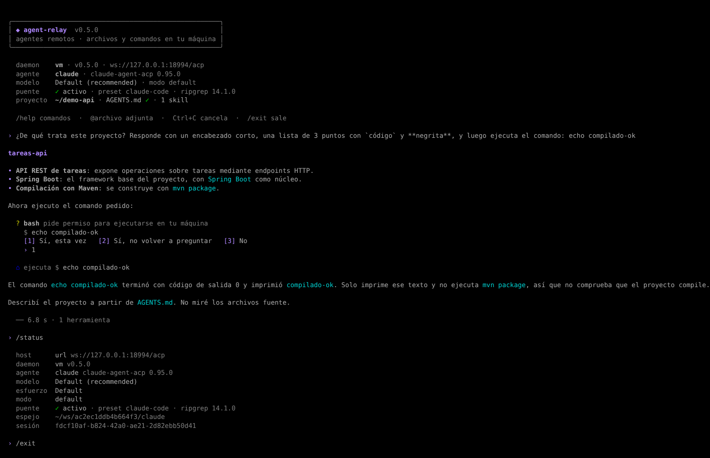
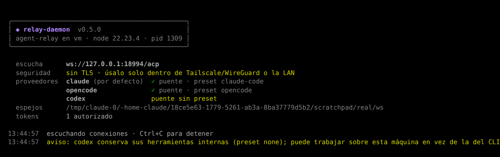

# agent-relay

CLI para usar agentes de código —**Claude Code**, **Codex** u **OpenCode**— que se ejecutan en **otra máquina** (AWS, un servidor en tu casa…), mientras leen, editan y ejecutan sobre **tu** proyecto local.

- **Todo el consumo de IA sale del daemon.** El CLI no tiene SDKs ni credenciales de proveedores; su única salida de red es el WebSocket hacia tu daemon.
- **Archivos y comandos en tu máquina.** Un puente de herramientas lleva cada lectura, edición, búsqueda y comando del agente a tu disco.
- **Formatos abiertos, sin atarte a un proveedor.** Tu proyecto solo usa [`AGENTS.md`](https://agents.md) y [Agent Skills](https://agentskills.io) en `.agents/`. Los archivos propios de cada proveedor (`CLAUDE.md`, `.claude/skills`…) se generan solo en el daemon.
- **La remota puede estar donde quieras.** La misma configuración sirve en tu LAN o en AWS, sobre Tailscale, WireGuard o un túnel SSH.
- Basado en el [Agent Client Protocol (ACP)](https://agentclientprotocol.com) y en [MCP](https://modelcontextprotocol.io). Funciona en macOS, Windows y Linux.

```
[tu máquina]                                  [remota: AWS o tu casa]
relay (CLI)                                     relay-daemon
 ├─ sin credenciales de IA                       ├─ único dueño de credenciales
 ├─ AGENTS.md + .agents/ (formato abierto)  ──►  ├─ workspace espejo por proyecto y proveedor
 ├─ lee/escribe archivos y ejecuta comandos      │   (AGENTS.md, skills, CLAUDE.md, .claude/skills…)
 │  por el puente de herramientas (MCP → ACP)   ├─ traduce rutas local ⇄ espejo
 └──── WebSocket (token + TLS/mTLS opcional) ────┘   y lanza claude-agent-acp / codex-acp / opencode acp
                 sobre Tailscale/WireGuard
```



## Contenido

- [Usos posibles](#usos-posibles)
- [Cómo funciona](#cómo-funciona)
- [Inicio rápido](#inicio-rápido)
- [Instalación y configuración en macOS](#macos)
- [Instalación y configuración en Windows](#windows)
- [Linux (servidor remoto, p. ej. AWS)](#linux-servidor-remoto)
- [Red entre las máquinas](#red-entre-las-máquinas)
- [Uso](#uso) · [Formatos abiertos](#formatos-abiertos-en-tu-proyecto) · [Solución de problemas](#solución-de-problemas) · [Seguridad](#seguridad) · [Desarrollo](#desarrollo)

## Usos posibles

agent-relay separa **dónde vive el modelo** (credenciales, consumo, proceso del agente) de **dónde ocurren las acciones** (archivos y comandos), y pone en medio un punto de control por el que pasa todo. Eso sirve para:

| Uso | Cómo se ve |
|---|---|
| **Una sola máquina con los agentes y las llaves** | Instalas y autenticas Claude Code, Codex u OpenCode una vez, en un servidor, y los usas desde tu portátil, el del trabajo o cualquier otro equipo. |
| **Modelos locales en una máquina potente** | El daemon corre en un PC con GPU (OpenCode con Ollama o llama.cpp). Tus portátiles usan esa GPU y el código no sale de tu red. |
| **Administrar servidores sin instalarles nada** | Ejecutas `relay` en un servidor (por SSH) y el daemon queda en tu máquina: el agente edita configuraciones y corre comandos allí sin llaves de API ni agente instalado. |
| **Equipos livianos** | Una Raspberry Pi, un portátil viejo o un Chromebook con terminal solo necesitan Node y el CLI; el proceso pesado vive en otra parte. |
| **CI/CD sin secretos en los runners** | `relay -p "revisa este cambio…"` en un pipeline; las llaves están solo en el daemon. |
| **Gateway de equipo** | Varios desarrolladores contra un daemon con las llaves de la organización: nadie tiene la API key en su máquina y el acceso se revoca quitando un token. |
| **Cambiar de proveedor sin cambiar de flujo** | Como el proyecto solo usa formatos abiertos, pasar de Claude Code a OpenCode es `relay -a opencode`. |

Como toda operación pasa por el puente del daemon, también es el lugar natural para agregar **auditoría** (registro de cada archivo leído y comando ejecutado) y **políticas** (prohibir leer `.env`, bloquear `rm -rf`, limitar carpetas). Están en la [hoja de ruta](#hoja-de-ruta).

## Cómo funciona

Los agentes usan sus propias herramientas (`Read`, `Edit`, `Bash`…), que corren dentro de su proceso, en la máquina remota. Para que actúen sobre tu proyecto, el daemon incluye un **puente de herramientas MCP**:

1. En cada sesión, el daemon le pasa al agente un servidor MCP propio (`relay`) con las herramientas `read`, `write`, `edit`, `bash`, `grep` y `glob`, y desactiva las herramientas internas equivalentes según el `preset` del proveedor.
2. Cuando el agente usa una de ellas, el daemon **no la ejecuta**: la convierte en una petición ACP estándar (`fs/read_text_file`, `fs/write_text_file`, `terminal/*`) y la envía a tu CLI por el WebSocket existente.
3. Tu CLI la ejecuta en tu máquina, dentro de la carpeta del proyecto, y devuelve el resultado.

```
[remota]                                                   [tu máquina]
agente ──mcp: read("src/a.ts")──► daemon ──ACP: fs/read──► relay (CLI)
                                                              │ lee tu disco
agente ◄──────── contenido ─────── daemon ◄──── contenido ────┘
```

Las rutas se traducen en ambos sentidos, así que el agente ve su workspace espejo de forma coherente. Si tu máquina es Windows, `bash` ejecuta **PowerShell** y el agente lo sabe.

| Proveedor | Estado del puente |
|---|---|
| Claude Code (`claude-agent-acp`) | **Verificado** con el preset `claude-code`: lectura, escritura, comandos y búsquedas ocurren en tu máquina. |
| OpenCode (`opencode acp`) | **Verificado** con el preset `opencode` (OpenCode 1.19): solo quedan las herramientas del puente y pide permiso antes de `write`, `edit` y `bash`. |
| Codex (`codex-acp`) | El handshake funciona y recibe las herramientas del puente, pero aún no hay preset para desactivar su shell interno, que puede seguir usando en la remota. |

## Inicio rápido

La forma más rápida de probarlo es con el daemon y el CLI en **la misma máquina**. Sigue la guía de tu sistema ([macOS](#macos) o [Windows](#windows)) con estos valores:

- En `daemon.yaml`: `listen.host: 127.0.0.1`.
- En el CLI, sin archivo de configuración: `RELAY_URL=ws://127.0.0.1:7443/acp` y `RELAY_TOKEN=<token>`.

Luego, desde cualquier proyecto:

```bash
relay doctor -a claude     # debe decir "✓ puente  activo (preset claude-code)"
relay -a claude
```

Pídele *"¿de qué trata este proyecto?"* o *"crea notas.txt con un resumen del README"*. Verás líneas `⌂ lee`, `⌂ escribe` o `⌂ ejecuta`, y los cambios aparecerán en tu proyecto. Para explorar, el agente usa `read`, `grep` y `glob`, que no piden permiso; te pregunta antes de escribir, editar o ejecutar.

Cuando funcione, separa las máquinas: cambia `listen.host` a la IP de la remota en tu red privada (ver [Red](#red-entre-las-máquinas)) y apunta el CLI a esa IP.

### Qué va en cada máquina

| | Máquina remota (daemon) | Tu máquina (CLI) |
|---|---|---|
| Node.js 20+ y agent-relay (`npm link`) | ✓ | ✓ |
| Proveedores (Claude Code, OpenCode, Codex) con su login | ✓ | — |
| `daemon.yaml` | ✓ | — |
| `cli.yaml` y token | — | ✓ |
| ripgrep | — | ✓ recomendado |
| Tailscale / WireGuard | ✓ | ✓ |

---

## macOS

### 1. Requisitos

Con [Homebrew](https://brew.sh):

```bash
brew install node git ripgrep
brew install --cask tailscale          # opcional: red privada entre tus máquinas
node --version                          # 20 o superior
```

> Si instalaste Node con el instalador de nodejs.org y `npm link` falla con `EACCES`, usa el Node de Homebrew o `nvm`, o configura un prefijo propio: `npm config set prefix ~/.npm-global` y agrega `~/.npm-global/bin` a tu `PATH`.

### 2. Instalar agent-relay

```bash
cd ~/Repositorios                       # o la carpeta que uses
git clone https://github.com/invincibleOf/agent-relay && cd agent-relay
npm install && npm run build && npm link
which relay relay-daemon                # ambos deben mostrar una ruta
```

Para actualizar más adelante: `git pull && npm install && npm run build`, y reinicia el daemon.

### 3. Daemon (si este Mac es la máquina remota)

Prepara los proveedores **en este Mac**, que es donde viven las credenciales:

```bash
# Claude Code: instálalo e inicia sesión una vez
claude                                  # dentro: /login
# OpenCode
npm i -g opencode-ai && opencode auth login
```

Genera el token y crea la configuración:

```bash
relay-daemon gen-token                  # guarda el token; el hash va en daemon.yaml
mkdir -p ~/.config/agent-relay
cp examples/daemon.yaml ~/.config/agent-relay/daemon.yaml
open -e ~/.config/agent-relay/daemon.yaml
```

Edita `listen.host` (`127.0.0.1` para la prueba local, o la IP de Tailscale de este Mac) y pega el hash en `auth.tokenSha256`. Luego:

```bash
relay-daemon check                      # valida y muestra el preset de cada proveedor
relay-daemon                            # Ctrl+C para detener
```



**Dejarlo corriendo siempre** (se inicia al entrar a tu sesión y se reinicia si falla), con el agente de launchd de [`examples/macos/dev.agent-relay.daemon.plist`](examples/macos/dev.agent-relay.daemon.plist):

```bash
sed "s/TU_USUARIO/$(whoami)/g; s#/opt/homebrew/bin/relay-daemon#$(which relay-daemon)#" \
  examples/macos/dev.agent-relay.daemon.plist > ~/Library/LaunchAgents/dev.agent-relay.daemon.plist
launchctl bootstrap gui/$(id -u) ~/Library/LaunchAgents/dev.agent-relay.daemon.plist
tail -f ~/Library/Logs/agent-relay.log
```

Para detenerlo: `launchctl bootout gui/$(id -u)/dev.agent-relay.daemon`.

### 4. CLI (tu Mac)

```bash
mkdir -p ~/.config/agent-relay
cp examples/cli.yaml ~/.config/agent-relay/cli.yaml
open -e ~/.config/agent-relay/cli.yaml  # ajusta hosts.casa.url, p. ej. ws://100.x.y.z:7443/acp
```

> **Ojo con TextEdit:** si creas el archivo desde cero, guárdalo como texto plano (*Formato → Convertir a texto plano*) y revisa con `ls -la ~/.config/agent-relay/` que no quede como `cli.yaml.txt` o `.rtf`. En Finder, la carpeta `.config` está oculta: `Cmd + Shift + .` la muestra.

Guarda el token. La opción más segura es el **Llavero de macOS**, para que no quede en texto plano en ningún archivo:

```bash
security add-generic-password -a "$USER" -s agent-relay-casa -w 'relay_…'
echo 'export RELAY_TOKEN_CASA="$(security find-generic-password -s agent-relay-casa -w 2>/dev/null)"' >> ~/.zshrc
source ~/.zshrc
```

Otras opciones: `export RELAY_TOKEN_CASA='relay_…'` (solo vale en esa terminal), o `tokenFile` en `cli.yaml` apuntando a un archivo con permisos `600`.

```bash
relay doctor                            # usa defaultHost (casa)
relay                                   # sesión interactiva
```

---

## Windows

Todos los comandos son para **PowerShell** (Windows Terminal recomendado). En Windows, la carpeta de configuración es `%USERPROFILE%\.config\agent-relay\`, es decir `C:\Users\<tu usuario>\.config\agent-relay\`.

> El soporte de Windows está cubierto por pruebas automáticas (comandos de PowerShell, rutas con `\`, arranque de proveedores `.cmd`), pero todavía no se ha probado de punta a punta en un Windows real. Si algo falla, abre un issue con la salida de `relay doctor`.

### 1. Requisitos

```powershell
winget install OpenJS.NodeJS.LTS
winget install Git.Git
winget install BurntSushi.ripgrep.MSVC
winget install tailscale.tailscale       # opcional: red privada entre tus máquinas
# Cierra y vuelve a abrir la terminal para que tome el PATH nuevo
node --version                           # 20 o superior
```

Si PowerShell muestra *"la ejecución de scripts está deshabilitada en este sistema"* al usar `npm` o `relay`, permite los scripts firmados para tu usuario:

```powershell
Set-ExecutionPolicy -Scope CurrentUser RemoteSigned
```

### 2. Instalar agent-relay

```powershell
cd $HOME\Repositorios                    # o la carpeta que uses
git clone https://github.com/invincibleOf/agent-relay; cd agent-relay
npm install; npm run build; npm link
Get-Command relay, relay-daemon          # ambos deben aparecer (en %APPDATA%\npm)
```

### 3. Daemon (si este Windows es la máquina remota)

Prepara los proveedores en esta máquina (por ejemplo `npm i -g opencode-ai` y `opencode auth login`, o Claude Code con su login). Luego:

```powershell
relay-daemon gen-token
New-Item -ItemType Directory -Force "$HOME\.config\agent-relay" | Out-Null
Copy-Item examples\daemon.yaml "$HOME\.config\agent-relay\daemon.yaml"
notepad "$HOME\.config\agent-relay\daemon.yaml"   # listen.host y auth.tokenSha256
relay-daemon check
relay-daemon
```

Si otra máquina se va a conectar, abre el puerto en el firewall de Windows **solo en la interfaz de Tailscale** (o la de tu VPN):

```powershell
# En PowerShell como administrador
New-NetFirewallRule -DisplayName "agent-relay" -Direction Inbound -Protocol TCP -LocalPort 7443 -InterfaceAlias "Tailscale" -Action Allow
```

**Dejarlo corriendo siempre**, como tarea programada que arranca al iniciar sesión y se reinicia si falla:

```powershell
powershell -ExecutionPolicy Bypass -File examples\windows\install-daemon-task.ps1
Get-Content "$env:LOCALAPPDATA\agent-relay\daemon.log" -Wait     # logs
```

### 4. CLI (tu Windows)

```powershell
New-Item -ItemType Directory -Force "$HOME\.config\agent-relay" | Out-Null
Copy-Item examples\cli.yaml "$HOME\.config\agent-relay\cli.yaml"
notepad "$HOME\.config\agent-relay\cli.yaml"      # hosts.casa.url, p. ej. ws://100.x.y.z:7443/acp
```

> Abre el archivo copiado en lugar de crearlo desde cero con el Bloc de notas, que suele guardarlo como `cli.yaml.txt`. Si pasa, relay te lo indica y te dice qué archivo renombrar.

Guarda el token como variable de entorno de tu usuario, para que persista entre terminales:

```powershell
[Environment]::SetEnvironmentVariable("RELAY_TOKEN_CASA", "relay_…", "User")
# Abre una terminal nueva para que la tome. Solo para la sesión actual:
$env:RELAY_TOKEN_CASA = "relay_…"
```

Para no dejarlo en una variable, usa `tokenFile` en `cli.yaml` (por ejemplo `tokenFile: ~/.config/agent-relay/casa.token`) y restringe el acceso a ese archivo a tu usuario.

```powershell
relay doctor
relay
```

**En una sesión con Windows como máquina local:**
- La herramienta `bash` del agente ejecuta **Windows PowerShell**, y las instrucciones del puente le indican usar sintaxis de PowerShell.
- `grep` y `glob` usan ripgrep si está instalado; si no, recurren a `Select-String` y `Get-ChildItem`, que son más lentos.

---

## Linux (servidor remoto)

Lo más habitual es que la máquina remota sea una instancia Linux (AWS, un VPS, un servidor en casa):

```bash
# Node 20+ (por ejemplo con nvm), git y, si quieres, Tailscale
git clone https://github.com/invincibleOf/agent-relay && cd agent-relay
npm install && npm run build && sudo npm link        # o sin sudo con nvm
relay-daemon gen-token
mkdir -p ~/.config/agent-relay && cp examples/daemon.yaml ~/.config/agent-relay/daemon.yaml
nano ~/.config/agent-relay/daemon.yaml
relay-daemon check
```

Como servicio de usuario de systemd, con [`examples/linux/agent-relay.service`](examples/linux/agent-relay.service):

```bash
mkdir -p ~/.config/systemd/user
sed "s#/usr/local/bin/relay-daemon#$(which relay-daemon)#" examples/linux/agent-relay.service > ~/.config/systemd/user/agent-relay.service
systemctl --user daemon-reload && systemctl --user enable --now agent-relay
sudo loginctl enable-linger "$USER"                  # que siga corriendo sin sesión abierta
journalctl --user -u agent-relay -f
```

En AWS no abras el puerto en el *security group* a todo internet: usa Tailscale, WireGuard o un túnel SSH (siguiente sección).

## Red entre las máquinas

El CLI solo necesita llegar al puerto del daemon. Cualquiera de estas opciones sirve, y en agent-relay solo cambian `listen.host` y la URL del CLI:

| Opción | Cuándo conviene | Configuración |
|---|---|---|
| **Tailscale** | La más simple. Funciona igual en tu LAN y fuera de ella, sin abrir puertos. Gratis para uso personal. | `listen.host`: IP de Tailscale de la remota (`tailscale ip -4`). URL: `ws://<esa-ip>:7443/acp` o `ws://<nombre-magicdns>:7443/acp`. |
| **Headscale** | Los mismos clientes de Tailscale, pero con el servidor de coordinación tuyo (por ejemplo en la instancia de AWS). | Igual que Tailscale. |
| **WireGuard** | Sin terceros. Ideal si la remota tiene IP pública (AWS). | `listen.host`: IP del túnel WireGuard. |
| **Túnel SSH** | Pruebas rápidas, sin instalar nada. | Remota con `listen.host: 127.0.0.1`. En tu máquina: `ssh -N -L 7443:127.0.0.1:7443 usuario@remota` y URL `ws://127.0.0.1:7443/acp`. |
| **TLS + mTLS directo** | Exponer el daemon sin VPN, restringido por certificado de cliente. | Sección `tls` con `clientCa` en `daemon.yaml`; `ca`, `cert` y `key` en `cli.yaml`. |

## Uso

```bash
relay                              # sesión interactiva con el proveedor por defecto
relay -a opencode                  # elige proveedor
relay -H aws                       # elige host de cli.yaml
relay -p "explica src/main.ts"     # un solo prompt y salir
relay -y                           # aprueba permisos automáticamente (con cuidado)
relay doctor                       # verifica conexión, agente, puente y ripgrep
```

Comandos dentro de la sesión:

| Comando | Qué hace |
|---|---|
| `/help` | Ayuda |
| `/new` | Nueva sesión con el agente |
| `/init` | Crea o mejora `AGENTS.md` (sin crear archivos de proveedor) |
| `/model [id]` | Muestra o cambia el modelo (si el agente lo permite) |
| `/mode [id]` | Muestra o cambia el modo del agente |
| `/commands` | Lista comandos personalizados y los que anuncia el agente |
| `/status` | Host, daemon, agente, modelo, puente, workspace espejo y sesión |
| `/clear` | Limpia la pantalla |
| `/exit` | Salir |
| `@ruta/archivo` | Adjunta un archivo local como referencia |
| `Ctrl+C` | Cancela el turno (dos veces seguidas para salir) |

Mientras el agente trabaja, cada operación sobre tu máquina aparece como una línea `⌂` (`lee`, `escribe`, `edita`, `busca`, `lista`, `ejecuta`), y cada turno termina con su duración y el número de herramientas usadas. Las respuestas se muestran con formato Markdown. Con `NO_COLOR=1`, o si la salida no es una terminal (por ejemplo `relay -p … > respuesta.md`), el texto sale sin colores ni formato; en modo `-p` el encabezado va a stderr para que stdout quede solo con la respuesta.

Cualquier otro `/comando` se busca en tus comandos personalizados; si no existe, se envía al agente (por ejemplo, los comandos propios de Claude Code).

## Formatos abiertos en tu proyecto

```
mi-proyecto/
├── AGENTS.md                      # instrucciones del proyecto (agents.md)
└── .agents/
    ├── skills/<nombre>/SKILL.md   # Agent Skills (agentskills.io)
    └── commands/<nombre>.md       # comandos personalizados
```

- Al conectarse, el CLI envía todos los `AGENTS.md` y el contenido de `.agents/` (máx. 1 MiB por archivo, 8 MiB en total).
- El daemon los escribe en el workspace espejo y los traduce al formato de cada proveedor según `skillsDirs` e `instructionAliases` (por ejemplo, `.claude/skills → .agents/skills` y `CLAUDE.md` con `@AGENTS.md`).
- Si el CLI encuentra `CLAUDE.md`, `.claude/`, `.codex/` u `.opencode/` en tu proyecto, te avisa para que migres ese contenido al formato abierto.

**Comandos personalizados:** `.agents/commands/<nombre>.md` (del proyecto) o `~/.config/agent-relay/commands/<nombre>.md` (globales). Frontmatter opcional con `description`; el cuerpo es la plantilla del prompt, con `$ARGUMENTS` (todo el texto) y `$1…$9` (por palabra). El CLI los expande localmente, así que funcionan igual con cualquier proveedor. Ejemplo: [`examples/commands/revisar.md`](examples/commands/revisar.md).

## Solución de problemas

| Síntoma | Causa y solución |
|---|---|
| `command not found: relay` (macOS) o *"relay no se reconoce"* (Windows) | Falta `npm link` en esa máquina, o la carpeta de binarios de npm no está en el `PATH`. Revisa con `npm prefix -g`. |
| *"la ejecución de scripts está deshabilitada"* (Windows) | `Set-ExecutionPolicy -Scope CurrentUser RemoteSigned`. |
| `No existe …/cli.yaml. Encontré "cli.yaml.txt"` | El editor agregó una extensión: renómbralo. |
| `…cli.yaml existe pero no define ningún host` | La clave debe ser `hosts:` y cada host debe ir indentado con espacios (no tabs). |
| `lee el token de la variable RELAY_TOKEN_CASA, que no está definida` | Defínela en esa terminal o de forma persistente (ver la guía de tu sistema). |
| `Token rechazado por el daemon (401)` | El hash en `daemon.yaml` no corresponde al token. Genera uno nuevo con `relay-daemon gen-token`. |
| `No se pudo conectar a ws://…` | El daemon no está corriendo, `listen.host` es `127.0.0.1` y te conectas desde otra máquina, la IP no es la de la remota, o el firewall bloquea el puerto. |
| El agente dice que el proyecto está vacío o solo ve `.relay-manifest.json` | Está usando sus herramientas internas sobre el espejo. `relay doctor` debe mostrar `✓ puente activo (preset …)`. Si dice `desconocido`, actualiza y reinicia el daemon. Si dice `preset none` o `desactivado`, revisa `toolBridge` en `daemon.yaml` (si lo omites, el preset se deduce del comando). |
| El agente pide iniciar sesión | Las credenciales viven en la **remota**: entra a esa máquina y haz el login del proveedor (`claude` → `/login`, `opencode auth login`, `codex login`). |
| Aviso por `.claude`, `.codex` u `.opencode` en el proyecto | No impide trabajar: el CLI solo sincroniza `AGENTS.md` y `.agents/`. |

Para depurar en el daemon: `RELAY_DEBUG=1 relay-daemon` muestra toda la salida de los adaptadores, y `RELAY_DEBUG_MCP=1` registra cada llamada del agente al puente.

## Seguridad

- **Token**: 256 bits aleatorios; el daemon solo guarda el hash SHA-256 y lo compara en tiempo constante.
- **Red**: el daemon debe escuchar solo en la interfaz de Tailscale/WireGuard, de la LAN o en `127.0.0.1` con túnel SSH. Sin TLS, lo advierte al arrancar.
- **TLS/mTLS**: opcional, TLS 1.3 mínimo; con `clientCa` se exige certificado de cliente.
- **Archivos locales**: el CLI solo permite leer, escribir y ejecutar dentro de la raíz del proyecto (y de `permissions.extraRoots`). Todo lo demás se rechaza.
- **Puente MCP**: escucha solo en `127.0.0.1` de la remota, con una URL secreta distinta por sesión que se invalida al cerrar la conexión.
- **Permisos**: con los presets `claude-code` y `opencode`, las herramientas de solo lectura (`read`, `grep`, `glob`) se aprueban solas; `write`, `edit` y `bash` siguen el flujo de permisos. En modo `-p` sin `--yes`, se rechazan.
- **Workspace espejo**: las rutas que llegan del CLI se validan (nada absoluto ni con `..`) antes de escribirse en el daemon.

## Desarrollo

```bash
npm run typecheck
npm test                 # pruebas unitarias + e2e con un agente ACP falso
npm run dev:daemon -- --config examples/daemon.yaml
npm run dev:cli -- doctor
```

```
src/
├── shared/
│   ├── protocol.ts        # handshake relay/hello ⇄ relay/ready y traducción de rutas
│   └── ui.ts              # estilos, cajas y filas para la terminal (sin dependencias)
├── daemon/
│   ├── main.ts            # servidor WebSocket, auth, TLS/mTLS, banner
│   ├── session.ts         # puente WebSocket ⇄ stdio del adaptador ACP
│   ├── tool-bridge.ts     # servidor MCP del puente: herramientas → ACP hacia el CLI
│   ├── presets.ts         # cómo desactivar las herramientas internas de cada agente
│   ├── workspace.ts       # workspace espejo y traducción a formatos de proveedor
│   └── auth.ts, config.ts
└── cli/
    ├── main.ts            # REPL, comandos, permisos, banner y doctor
    ├── transport.ts       # conexión con el daemon → Stream ACP
    ├── local-tools.ts     # fs y terminales en tu máquina
    ├── project.ts         # raíz del proyecto y archivos en formato abierto
    ├── commands.ts        # comandos personalizados y /init
    ├── render.ts          # herramientas, permisos y pie de cada turno
    ├── markdown.ts        # Markdown en streaming para la terminal
    └── config.ts
examples/
├── daemon.yaml, cli.yaml, commands/
├── macos/dev.agent-relay.daemon.plist
├── linux/agent-relay.service
└── windows/install-daemon-task.ps1
test/
├── fake-agent.ts          # agente ACP de prueba
├── e2e.test.ts            # daemon + CLI + agente falso de punta a punta
├── unit.test.ts
└── markdown.test.ts       # renderizado Markdown en streaming
```

## Hoja de ruta

1. ~~Puente MCP de herramientas locales~~ (v0.2) · ~~Preset de OpenCode~~ (v0.3) · ~~Soporte de Windows en el puente~~ (v0.7).
2. Auditoría y políticas en el puente: registro firmado de operaciones, rutas y comandos prohibidos.
3. Preset para Codex que desactive su shell interno.
4. Reconexión y reanudación de sesiones (`session/load`).
5. Sincronización en vivo de `AGENTS.md` y `.agents/` cuando cambian durante la sesión.

## Licencia

MIT
